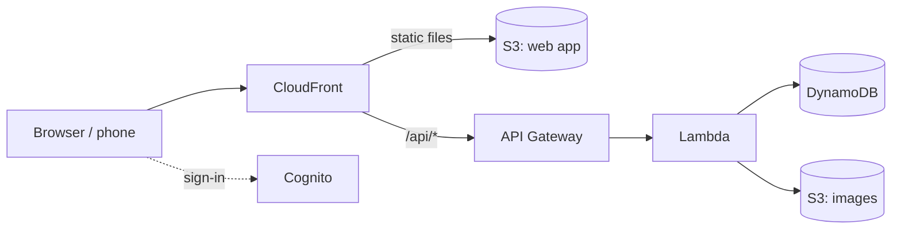

<p align="center"></p>

# Blade Notes

A personal notes and tasks app built around **blades**: click a space or folder and its contents open in a new column to the right. Folders nest as deep as you like; once more than three columns are open, the older ones fold into thin strips you can click to reopen.

- Spaces, folders, notes and tasks in one tree, any depth
- Rich text (Tiptap): headings, lists, checklists, quotes, code, tables, links, images
- Tasks with status, due date, priority and a rich-text description
- Works offline: the whole library is kept in the browser and syncs when online
- Search across titles and note text (⌘K), light and dark mode
- Dates while you write: type `@sun 3pm` anywhere; an Agenda by space or day; Google, Outlook and iCloud calendars; times follow you across time zones
- Secret blocks for passwords, encrypted in the browser with your own passphrase; everything else encrypted at rest with the app's own KMS key
- Copy a whole note or task as rich text and Markdown, dates and descriptions included
- Settings › How to lists every gesture and shortcut

Runs in the browser and as desktop apps for **macOS (Apple Silicon)** and **Windows (x64)**, which update themselves from GitHub Releases (Settings → About & updates). Mobile apps (Expo) and AI features come next.

## Desktop apps

Download the latest from [Releases](../../releases/latest):

- **macOS:** `BladeNotes-macOS.dmg`, drag Blade Notes to Applications. The app isn't notarized yet, so the first time right-click it → Open, or run `xattr -dr com.apple.quarantine "/Applications/Blade Notes.app"`.
- **Windows:** `BladeNotes-Windows-x64.zip`, unzip anywhere you can write to (for example `%LOCALAPPDATA%\Programs\Blade Notes`) and run `BladeNotes.exe`. Nothing else to install; WebView2 ships with Windows 10 and 11.

Both are thin native windows around the web app (`apps/desktop-macos` in Swift/WebKit, `apps/desktop-windows` in .NET/WebView2), so they always show the latest web version and keep their own sign-in and offline data. A tag `v*` builds both and publishes the release (`.github/workflows/release.yml`).

## How it runs



Serverless on AWS, so an idle account costs almost nothing (well under $1/month for one person). Docs: [docs/README.md](docs/README.md) (architecture, runbooks, decisions, work logs, design records).

| Folder | What |
|---|---|
| `apps/web` | React + Vite web app |
| `packages/core` | Shared types and fractional ranks |
| `services/api` | The Lambda behind `/api` (sync, uploads, files) |
| `services/calendar` | Calendar sync: `/api/calendar` and a worker on the table's stream |
| `infra` | AWS CDK stack: DynamoDB, S3, Cognito, API, CloudFront, DNS |
| `assets/icon` | App icon sources |
| `docs` | Architecture, runbooks, decisions, work logs, design records |

## Deploy your own

Needs Node 22+, pnpm, an AWS account with a Route 53 hosted zone, and the AWS CLI signed in.

```bash
pnpm install
cp .env.example .env        # set your domain, zone and a unique sign-in prefix
cd infra && npx cdk bootstrap   # once per account and region
cd .. && AWS_PROFILE=<profile> pnpm deploy
```

Sign-up is switched off, so create your own user once:

```bash
aws cognito-idp admin-create-user --user-pool-id <UserPoolId from the deploy output> --username you@example.com --user-attributes Name=email,Value=you@example.com Name=email_verified,Value=true
```

Cognito emails a temporary password; you choose a new one at first sign-in.

## Develop

```bash
pnpm dev      # http://localhost:5173, talking to the deployed API
pnpm test
pnpm typecheck
```

## License

MIT
