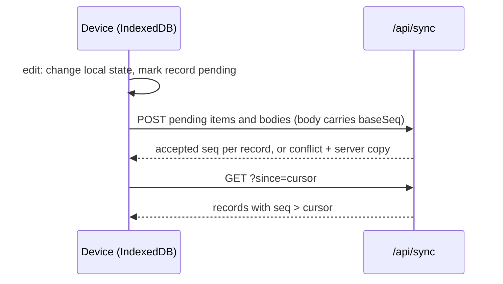

# Data model, storage and sync

## Data model

Everything is an `Item` in one tree (`packages/core/src/types.ts`): `space` (root level), `folder`, `note`, `task`. Each has a `parentId` and a fractional `rank` for its position among siblings, so moving one item rewrites only that item. Depth is unlimited. Deleting sets `deletedAt` (trash) on the item and everything under it.

Two kinds never show in the blades; their `parentId` is the note or task they belong to:

| Type | What | Doc |
|---|---|---|
| `description` | Hidden text behind a list item or phrase | (the editor's `describe.ts`) |
| `event` | A date typed with `@` | [03-dates-and-agenda.md](03-dates-and-agenda.md) |

A note's text, and a task's description, is a separate `Body` (Tiptap JSON), so listing a folder never loads note text.

## Storage (DynamoDB, one table)

| pk | sk | holds |
|---|---|---|
| `USER#` | `ITEM#<id>` | an item |
| `USER#` | `BODY#<id>` | a body |
| `USER#` | `SETTINGS#settings` | settings, synced like items |
| `USER#` | `META#counter` | the account's write counter |
| `USER#` | `CAL#<provider>`, `CALMAP#<id>` | calendar sign-in and where each date was written ([04](04-calendar-sync.md)); never synced |
| `CALSTATE#<state>` | `CALSTATE` | one-time OAuth state, 10 minutes (`ttl`) |

Every write takes the next number from the counter as its `seq`. The `bySeq` index (`pk`, `seq`) answers "what changed after N" — that is the whole sync protocol; records without a `seq` (calendar records) never reach a device. Point-in-time recovery is on (35 days). The table's stream feeds the calendar worker. Files live in S3 under `users//`. Everything at rest is encrypted with the app's KMS key ([02-security.md](02-security.md)).

## Sync

- Items are last-write-wins.
- A body is only written if the stored one is still the version the edit started from (`baseSeq`). Otherwise the server keeps its copy and the device saves its own text as a sibling note named "… (conflict copy)". Nothing is lost.
- While a record is pending on a device, pulled versions of it are skipped until the push lands.
- Devices sync on start, every 10 s while visible, and on focus or reconnect. The same tick checks the clock: when the day or the device's time zone changed, everything redraws (see [03](03-dates-and-agenda.md#time-zones)).

## Sign-in

Cognito user pool with sign-up off. The web app uses the authorization-code flow with PKCE (`apps/web/src/auth.ts`). The HTTP API checks the access token's JWT on every route except `/api/calendar/callback` (the provider's redirect; a one-time state is its key). Files need sign-in too: `GET /api/files/<owner>/<uuid>.<ext>` answers the owner only, with a 60-second signed S3 link the app fetches into memory. Details: [02-security.md](02-security.md).

## Hosting

CloudFront serves the web app from S3 and forwards `/api/*` to the HTTP API, so the app and API share one origin (no CORS). `config.json` (region, client id, sign-in URL) is written at deploy time, so the build holds no account-specific values. Deployment-specific settings come from `.env`, never from code.
