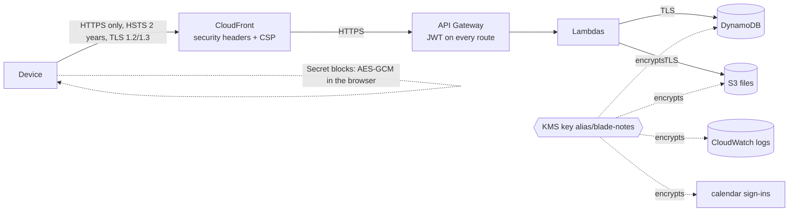

# Security

Two layers. The server layer (phase 1) protects stored data and traffic with an AWS KMS key; the app's own server can still read notes, because it has to sync them. Secret blocks (phase 2, [05](05-secret-blocks.md)) are encrypted in the browser with a key that never leaves the device, so not even someone inside the AWS account can read them.

## At rest

| What | Encryption |
|---|---|
| Notes table (items, bodies, settings, calendar records) | KMS key `alias/blade-notes` (customer managed, yearly rotation) |
| Files bucket | SSE-KMS with the same key, S3 bucket key on; files from before the switch were copied onto the key in place on 2026-11-11 (their older versions stay in version history under the S3 key) |
| API and calendar logs | Same key; no note text is ever logged |
| Backups (35-day point in time, S3 versions) | Follow the table's and bucket's key |
| Calendar refresh tokens, iCloud app password | Sealed with KMS `Encrypt`, encryption context `{sub, provider}` |
| Secret blocks | Ciphertext from the browser; the server never sees the key |

Every use of the key is in CloudTrail; disabling the key locks the data at once. AWS makes and rotates the key material. Bringing your own key later: [decision 0003](../decisions/0003-kms-key-now-own-key-later.md).

## In transit

- CloudFront: HTTP redirects to HTTPS, policy `TLSv1.2_2021` (TLS 1.2 and 1.3), HSTS `max-age` two years with subdomains.
- CloudFront to API Gateway: HTTPS only. Lambda to DynamoDB, S3 and KMS: TLS (AWS SDK). The files bucket refuses plain HTTP (`enforceSSL`).

## Browser hardening (CloudFront response headers)

| Header | Value, in short |
|---|---|
| Content-Security-Policy | scripts only from the site; styles may be inline (React, the editor); images from the site, `data:`, `blob:`, `https:`; network only to the site, Cognito and the files bucket; no framing, no plugins |
| X-Frame-Options | `DENY` |
| Referrer-Policy | `no-referrer` |
| X-Content-Type-Options | `nosniff` |
| Permissions-Policy | camera, microphone, location, payment, USB off |

The CSP is the main guard against a script injected into the page (for example through a bad dependency) reading notes or tokens.

## Sign-in

- Cognito, sign-up off, code flow with PKCE, access token 1 hour, refresh token 30 days.
- **Two-step sign-in** (TOTP): Settings › Security, set up from the app with the user's own access token (scope `aws.cognito.signin.user.admin`). The pool's MFA is `OPTIONAL`; once a user turns it on, every sign-in asks for the code.
- Sign-out revokes the refresh token (`/oauth2/revoke`); **Sign out everywhere** calls `GlobalSignOut`.

## Files

`GET /api/files/<owner>/<name>` needs the JWT and answers only when `<owner>` is the caller: a 60-second signed link (`Cache-Control: no-store` on the object), which the app fetches into a blob URL. Images in notes render through that (`SignedImage` in `Editor.tsx`); downloads ask with `?name=`.

## Alerts

With `NOTES_ALERT_EMAIL` set, an email goes out when a KMS key is disabled, scheduled for deletion or has its policy changed, and when the AWS root user signs in. A write-only, single-region trail (global events included) feeds EventBridge; its log bucket keeps 365 days. Runbook: [security-alerts.md](../runbooks/security-alerts.md).

## What each layer stops

| If this happens | Stopped by |
|---|---|
| A disk or backup leaves an AWS data centre | KMS at rest (AWS's own key did this before; the KMS key adds the audit trail and the off switch) |
| Someone reads Wi-Fi traffic | TLS + HSTS |
| A file link leaks | Files need sign-in, links live 60 s |
| A bad script runs in the page | CSP (helps); Secret blocks (locked ones stay unreadable) |
| The password leaks | Two-step sign-in |
| Someone gets into the AWS account | KMS logs it and can be cut off; only Secret blocks stay unreadable |
| A laptop is taken while unlocked | Secret blocks (lock after 5 idle minutes) |

The design record with the before/after comparison: [design/security.html](../design/security.html).
