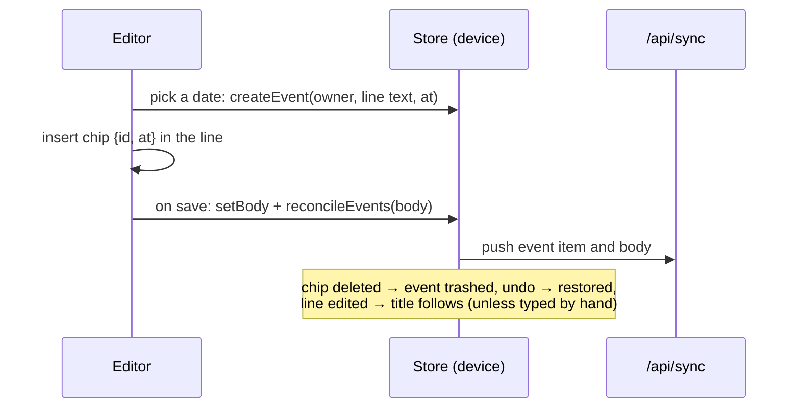

# Dates typed with @, events and the Agenda

Type `@` and a day while writing, and that line gets a date: a chip in the text, an event the Agenda lists, and (with a calendar connected) an entry in your calendar. Times follow you across time zones.

**Code:** `packages/core/src/when.ts` (zones), `apps/web/src/dates.ts` (parser, labels), `apps/web/src/schedule.ts` (chip, @ trigger, paste rule), `apps/web/src/DatePicker.tsx`, `apps/web/src/Agenda.tsx`, `apps/web/src/store.ts` (`createEvent`, `reconcileEvents`, `checkClock`). Tests: `when.test.ts`, `dates.test.ts`, `schedule.test.ts`.

## The gesture

`@` at the start of a word (after a space or at the line start) opens the date picker; an email's `@` follows a letter, so it never does. What can follow it: `today`, `tom 9am`, `sun`, `next fri 3pm`, `15 nov`, `nov 15`, `15/11`, `in 3 days`, `in 2w`, `3pm` (`apps/web/src/dates.ts`, tested in `dates.test.ts`). Esc keeps the text as typed. Why `@`: [decision 0001](../decisions/0001-at-sign-for-dates.md).

## Chip and event

| Piece | Where | Holds |
|---|---|---|
| `event` item | synced like any item | `title`, `at`, `tz`, `status` (`todo`/`done`), `private`, `customTitle`; `parentId` = the note, task or description |
| Chip node `dateChip` | in the body (Tiptap JSON) | `{ id, at }`; `at` is a copy so a copied chip still says its date |

The item is the truth; the chip popup edits both. Removing the chip trashes the event; trashing a note trashes its events with it.

## Time zones

Two kinds of value, and only two (`packages/core/src/when.ts`, tested in `when.test.ts`):

| Kind | Stored as | Shown |
|---|---|---|
| All day | `2026-11-15` | the same day everywhere |
| Timed | `2026-11-15T09:00:00+06:00` (offset of the device that set it) | that moment in the zone the device is in **now**: 9:00 set in Dhaka (UTC+6) is 8:30 in India (UTC+5:30) |

`tz` (e.g. `Asia/Dhaka`) is kept for calendars and for the popup's "Set as 09:00 in Asia/Dhaka" line. Labels are computed on every render from the device clock; `checkClock()` runs on every sync tick and on focus, and redraws everything when the date or the zone changed, so landing in another country updates open screens without a reload. Changing a date in the popup keeps the wall time you see and records the zone you are in.

## Agenda

A blade opened from the Library: every open event and every open task due date (`Agenda.tsx`), plus today's and future done ones struck through. Grouped by space (default) or by day: Overdue, Today, Tomorrow, then dates. A row opens its note or task (with its folders) and the chip flashes. The Library row shows how many are due today or late.

## Copy and paste

Covered in [06-copy-and-paste.md](06-copy-and-paste.md).
