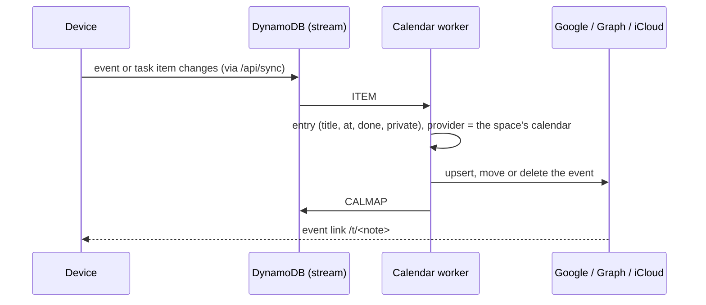

# Calendar sync

One Lambda, `services/calendar`: the `/api/calendar` routes and a worker on the table's stream. Dates go one way, from Blade Notes to a **"Blade Notes" calendar** it creates in each connected account, so nothing else in that account is touched.

## What is written

| Item | Calendar event |
|---|---|
| `event` | its title (or "Blade Notes reminder" when `private`), 30 minutes at `at`, or all day |
| task with `due` | the task title, all day |
| done | title starts with ✓ |
| trashed, chip removed, due cleared | deleted |

Which calendar: the space's choice in Settings › Calendars, else the default; none → nothing written (and any earlier copy removed). Moving a space to another calendar applies to dates written from then on; Settings › Calendars › Sync now writes them all again.

## Providers

| Provider | Sign-in | Calendar | Ids |
|---|---|---|---|
| Google | OAuth, scope `calendar.app.created` (only calendars the app made) | created on connect | event id = item id without dashes (idempotent) |
| Outlook | OAuth (Microsoft identity, `common`), `Calendars.ReadWrite` | created on connect | from `CALMAP#` |
| iCloud | Apple ID + app-specific password (CalDAV, Basic auth) | `MKCALENDAR …/blade-notes/` | `<item id>.ics` |

Google gets times with their offset and `tz`; Graph and iCloud get UTC. Tokens and the iCloud password are sealed with the KMS key. A provider is offered only when its OAuth app is in SSM (`/blade-notes/google-oauth`, `/blade-notes/microsoft-oauth`); setup: [calendar-setup.md](../runbooks/calendar-setup.md).

## Routes

| Route | Auth | Does |
|---|---|---|
| `GET /api/calendar` | JWT | status per provider: configured, connected, account, last sync, last error |
| `POST /api/calendar/connect` | JWT | Google/Outlook: sign-in URL; Apple: checks and stores the password |
| `GET /api/calendar/callback` | one-time state | finishes OAuth, creates the calendar, writes existing dates, returns to `/?calendar=<provider>` |
| `POST /api/calendar/disconnect` | JWT | forgets the sign-in; events already written stay |
| `POST /api/calendar/resync` | JWT | writes every date from the last 30 days on |

## Failures

Network, 429 and 5xx are retried by the stream (3 times, bisecting the batch); other errors are stored as `lastError` on `CAL#<provider>` and shown under the provider in Settings, never retried in a loop.

Desktop apps: Google refuses sign-in inside embedded web views, so Google and Outlook are connected once from a browser; the connection is per account, so it then works everywhere.
