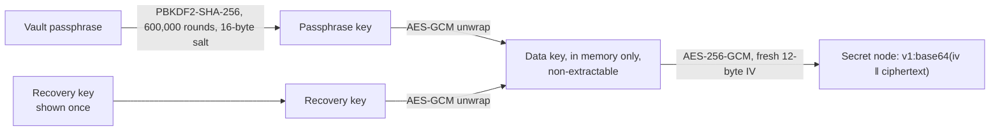

# Secret blocks

Passwords and PINs inside a note, encrypted in the browser (`apps/web/src/vault.ts`, `secret.ts`, `VaultPanel.tsx`). The server, AWS, backups, search and calendars only ever hold ciphertext.

- `Settings.vault` (synced) holds the salt, the iteration count and the data key wrapped twice: by the passphrase key and by the recovery key. Never the key itself.
- Unlocked = the data key is in memory as a non-extractable `CryptoKey`. It locks after 5 idle minutes and on Lock now.
- The `secret` node keeps `{ label, data }`. On screen: dots with Reveal (30 s), Copy (clipboard cleared after 30 s where the browser allows) and Edit.
- Copy as plain text gives `••••••`; rich copy keeps the ciphertext, so pasting inside Blade Notes keeps the secret.
- Lost passphrase and recovery key = lost secrets. Changing the passphrase needs the current one or the recovery key.

Why in the browser and not KMS: [decision 0004](../decisions/0004-secret-blocks-in-the-browser.md).
