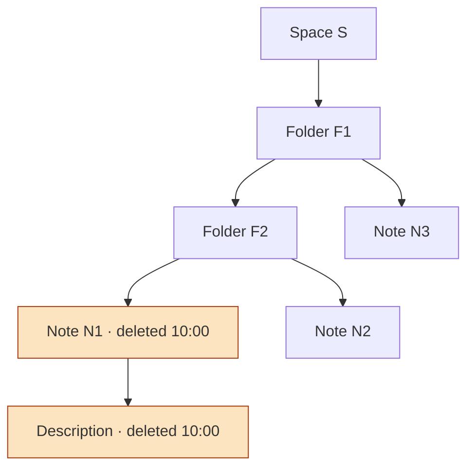

# Trash: delete, restore, delete for good

Deleting a note, task, folder, space or attachment moves it to the Trash (in the Library). It waits there 30 days, then it is deleted for good. Restore brings back exactly what that one delete took, never a sibling; if the place above it is in the trash too, that place comes back as well, without its other contents.

**Code:** `packages/core/src/trash.ts` (every rule, pure, shared by app and server), `apps/web/src/store.ts` (`trash`, `restore`, `deleteForever`, `detach`, pull), `apps/web/src/Trash.tsx` (the blade), `services/api/src/handler.ts` (tombstone wins on push), `services/api/src/purge.ts` (daily job), `infra/lib/notes-stack.ts` (schedule, file lifecycle). Tests: `packages/core/src/trash.test.ts`.

## One rule: one delete, one moment

Everything one delete takes gets the same `deletedAt`, to the millisecond. "Deleted together" is "same moment"; no extra field. Something already in the trash keeps its own moment, so it stays its own trash line.



Deleting F1 at 11:00 then marks F1, F2, N2, N3 with 11:00; N1 and its description keep 10:00. The Trash shows two lines: **F1** (with 3 inside) and **N1** ("F2 is in the trash too").

## Rules

| Action | Takes / brings | Never touches |
|---|---|---|
| Delete an item | it + everything under it not in the trash yet (descriptions and dates included) | parent, siblings, other branches, things already in the trash |
| Delete an attachment | that attachment (`Attachment.deletedAt`; it stays in its item's list) | the item's other attachments |
| Restore a trash line | everything that delete took | siblings; anything deleted earlier on its own |
| …whose place is in the trash | also each trashed place above it, with its own text (descriptions, dates) | the places' other notes, tasks, folders: they become their own trash lines |
| Delete for good (by hand) | the item + everything under it, earlier separate deletes inside included | anything not in the trash |
| 30 days after a delete | the same, by itself (server, daily) | — |

Descriptions and dates are part of their note's text: never a trash line of their own. A date whose chip was deleted from the text, or a description unlinked from it, sits in the trash unseen and goes for good after 30 days.

## Your case, step by step

| When | Action | Trash shows |
|---|---|---|
| 10:00 | delete `bill.pdf` from note "Bazar" | `bill.pdf` (in Bazar) |
| 11:00 | delete note "Bazar" | "Bazar"; `bill.pdf` ("Bazar" is in the trash too) |
| then | restore `bill.pdf` | asks first; "Bazar" comes back with its text and `bill.pdf`; nothing else |
| or | restore "Bazar" | "Bazar" without `bill.pdf` (it was gone before); `bill.pdf` stays a trash line |
| or | delete "Bazar" for good | "Bazar" and `bill.pdf`, both |

## Deleting for good

```mermaid
sequenceDiagram
  participant D as Device
  participant A as /api/sync
  participant J as Purge job (daily 03:30 Dhaka)
  participant S as S3 files
  D->>A: tombstones (Delete for good / Empty trash)
  J->>A: tombstones for anything 30 days in the trash
  J->>J: cleanup(): files nothing else uses, tombstones' bodies
  J->>S: delete those files (old version kept 7 days)
  J->>A: delete bodies; store tombstones without file addresses
  A-->>D: pull brings tombstones: drop item and text
```

- A **tombstone** is the item record with `purgedAt`, its place in the tree and no text. It keeps file addresses only until the job has freed them.
- **A tombstone always wins.** The server refuses an item write over a tombstone (an edit or restore from a device that had not heard yet), and a device applies a pulled tombstone even over its own pending edit.
- **A file goes only when nothing still around points at it**: no live or trashed attachment, and no image in any remaining text (an image pasted into two notes is one file).
- Every job step is safe to repeat; a write only lands if nobody wrote the item since the job read it.
- Files bucket: noncurrent versions expire after 7 days, so a deleted file is fully gone a week later.
