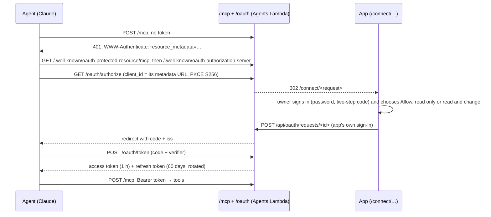
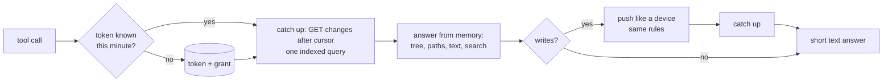

# AI agents: the MCP server and how agents sign in

Claude (web, desktop, phone, Claude Code) and other AI agents reach the library through an [MCP](https://modelcontextprotocol.io) server at `https://<site>/mcp`. The agent signs in through the app: the owner sees who asks, picks read only or read and change, and can disconnect it any time in Settings › Connected apps. Nine tools cover finding, reading and changing everything; note text travels as Markdown, so an agent edits it the way it writes.

**Code:** `services/api/src/mcp/index.ts` (Lambda entry, routes), `tools.ts` (tools and the agents' instructions), `library.ts` (warm copy of the account, search, agenda), `markdown.ts` (Tiptap ⇄ Markdown), `oauth.ts` (authorization server), `services/api/src/sync.ts` (the same push and pull as devices), `apps/web/src/Agents.tsx` (consent page, Connected apps), `infra/lib/notes-stack.ts` (`Agents`). Tests: `services/api/src/mcp/*.test.ts`.

## Connecting

| Part | How |
|---|---|
| Discovery | Protected resource metadata (RFC 9728) and authorization server metadata (RFC 8414) on the site; the issuer is the site |
| Client identity | Client ID metadata document (the client's own https URL; Claude and Claude Code use it; public names only, no ports, at most 64 kB, 5 s) or dynamic registration (RFC 7591) for other agents |
| Redirects | Exact match; `http://localhost` and `127.0.0.1` on any port for apps on this computer (RFC 8252) |
| Code | PKCE S256 only, 2 minutes, works once (read and delete in one step); the response carries `iss` (RFC 9207) |
| Tokens | Random; only their SHA-256 is stored, with a TTL. Refresh tokens rotate: each works once |
| Scopes | `notes:read` always; `notes:write` only when asked for (or no scope asked) and the owner ticks Change. A read-only agent is not shown the writing tools at all |
| Grant | One per app (`USER#` `GRANT#<id>`): name, scope, time zone, connected, last used. Disconnecting deletes it; every token checks it (remembered for at most a minute) |

Records: `OAUTH#client#…`, `OAUTH#request#…` (10 min), `OAUTH#code#…`, `OAUTH#token#…` in the same table, outside every user partition and without `seq`, so devices never sync them. Why the app does the sign-in instead of Cognito: [decision 0006](../decisions/0006-agents-sign-in-through-the-app.md).

## Tools

| Tool | For | Notes |
|---|---|---|
| `overview` | "What do I have?" | Today and time zone, totals, each space with counts, recent edits, late and coming up |
| `browse` | A place's tree | Depth 1–6, at most 400 lines |
| `search` | Find, filter, count | Words (all must be there, `"phrases"`) over titles, text and hidden descriptions; filters for type, place, status, priority, due, edited, pinned, files, trash; sort; pages; `count_by` returns only counts |
| `agenda` | Dates and due tasks | Day by day plus what is late; optional time zone |
| `read` | Full content, up to 10 items | Markdown text with its `version`, hidden descriptions, files, what is inside |
| `create` | New items, up to 50 | Later items may be placed in earlier ones by path; text is Markdown |
| `update` | Fields and moves, up to 50 | Also dates in a text (move, tick, rename) |
| `edit` | Change a text | `replace` (find must match once, or `all`), `prepend`, `append`, `set`; `version` guards against edits in between |
| `trash` | Trash or restore, up to 50 | Deleting for good stays in the app |

Items are named by a short id (8+ characters, longer only where two ids share a start), a path (`Work/Projects/Plan`) or a unique title. Mistakes come back as advice (`isError`): what was not found, and what is there. The server's `instructions` (in `tools.ts`) are the agents' manual: the model, how to refer to items, good habits and the Markdown below.

## Text as Markdown

`markdown.ts` turns a body into Markdown and back. Parts of the app become links, so they survive:

| In the app | In Markdown |
|---|---|
| Date chip | `[@Fri 2026-11-21 09:00](date:3f9a1c2e)`; new: `[@2026-11-21 14:30](date:new)` |
| Description on a phrase | `[phrase](desc:5b2e0c11)`; new: `[phrase](desc:new "hidden text")` |
| Description on a list item | `- item [›](desc:5b2e0c11)` |
| Secret block | `[🔒 label](secret:<sha-256 of the ciphertext, 8 hex>)`: the agent can move or delete it, never read or make one |
| Picture in the text | `` |
| Underline, highlight, line break | `<u>`, `<mark>`, ` `; bold/italic/strike next to punctuation use `<strong>`, `<em>`, `<s>` |

An edit only parses the stretch of text that changed: whole blocks before the first changed character and after the last one keep their nodes, so anything Markdown cannot say survives where the agent did not write. A changed block that Markdown cannot hold whole (a list inside a table cell, a phrase that is both a link and a description) is refused with a message; deleting it is allowed. After a text changes, its dates follow the same rule as in the editor (core `eventChanges`: removed chip → event in the trash, title follows its line), and descriptions whose link left the text go to the trash. Tests: random strings and random mark combinations come back unchanged (`markdown.test.ts`).

## Fast and light

- The Lambda keeps a copy of the account in memory (1 GB) and brings it up to date with the sync protocol itself: one query on `bySeq`, usually empty. A cold start reads the account once.
- Search, counts, paths and the agenda run in memory; the plain text of each body is kept while its `seq` is unchanged. Measured live: 8–17 ms per read call on a warm Lambda, 40–180 ms per write, about 110 ms for the first call that reads the account ([work log](../work-logs/2026-11-15-mcp-server.md)).
- Answers are compact text lines, not JSON: short ids, paths, days with weekday. Batches (`read` 10, others 50) save round trips.
- Writes go through `push` in `sync.ts`, so size limits, tombstones and the body version check are the same as for devices; a device with older text gets its usual conflict copy. An edit saves the text first: if the app changed it in between, nothing else (dates, descriptions) is saved either.
- Accepted writes go into the copy at once, because the `bySeq` index can lag a moment; the copy is read whole again every 15 minutes.
- Time zone: what `agenda` is told (an IANA name; offsets like `-05:00` are refused), else the zone of the device that last set a date, else the zone of the browser that approved the connection. Each answer names it.

## Logs and limits

The log line per call has the route, MCP method, tool name, status and time, never text or arguments. A body over the 350 kB limit or a record over 100 kB is refused with the reason. Files attached to notes are listed by name and size; their contents are not served to agents yet.
